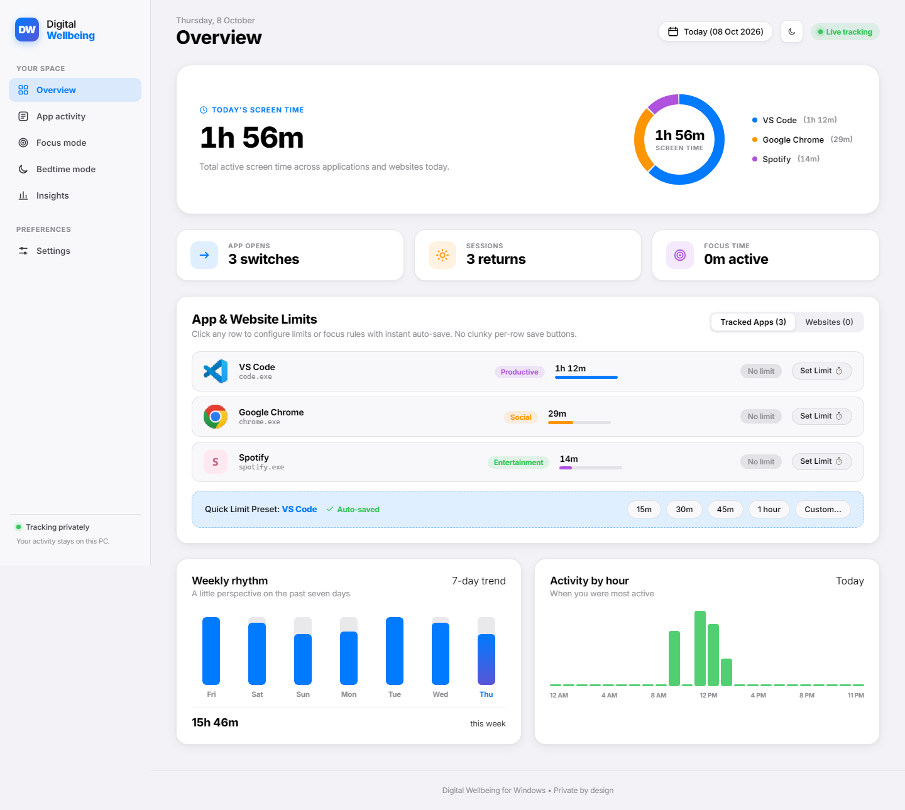
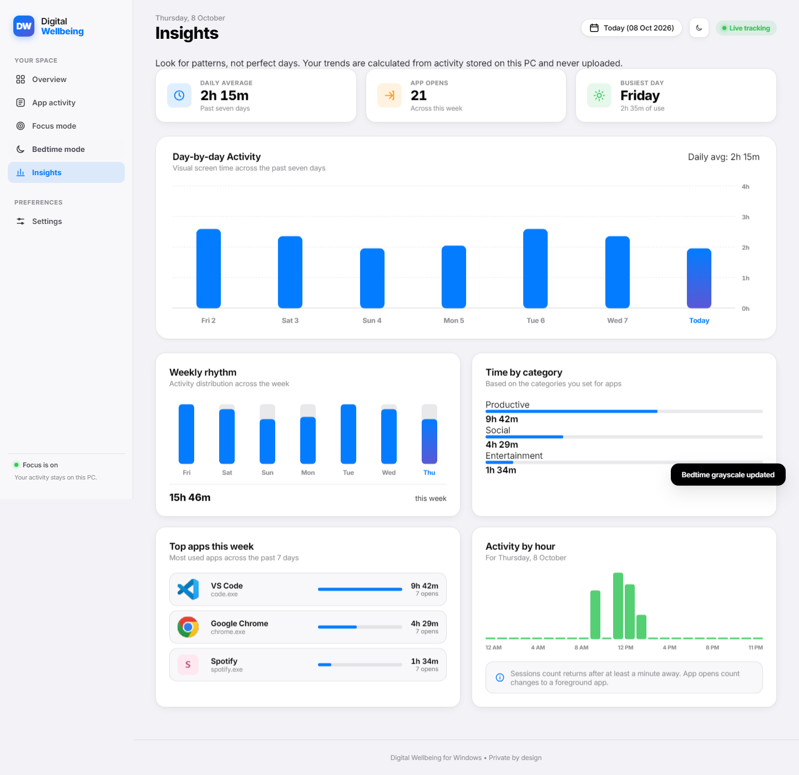
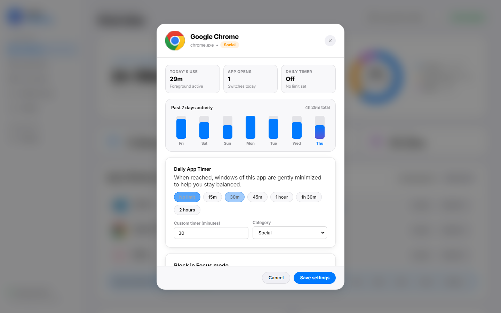
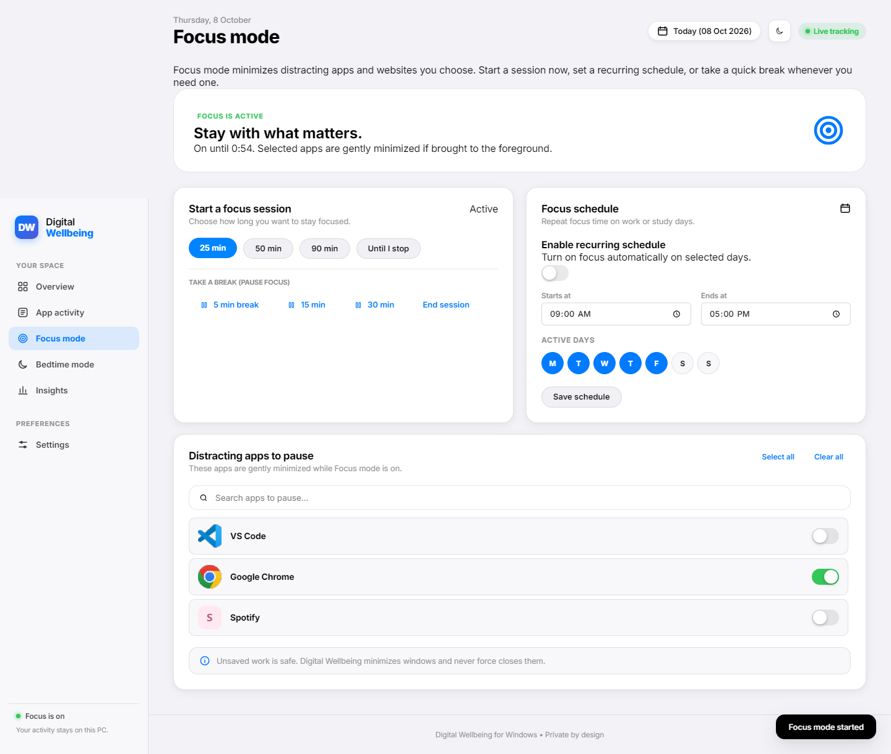
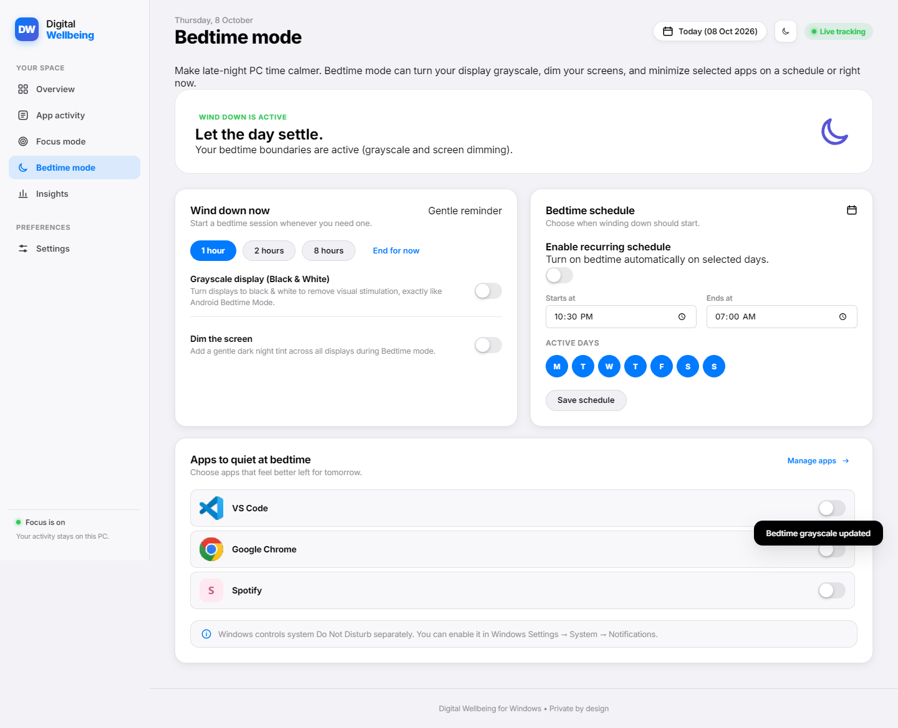
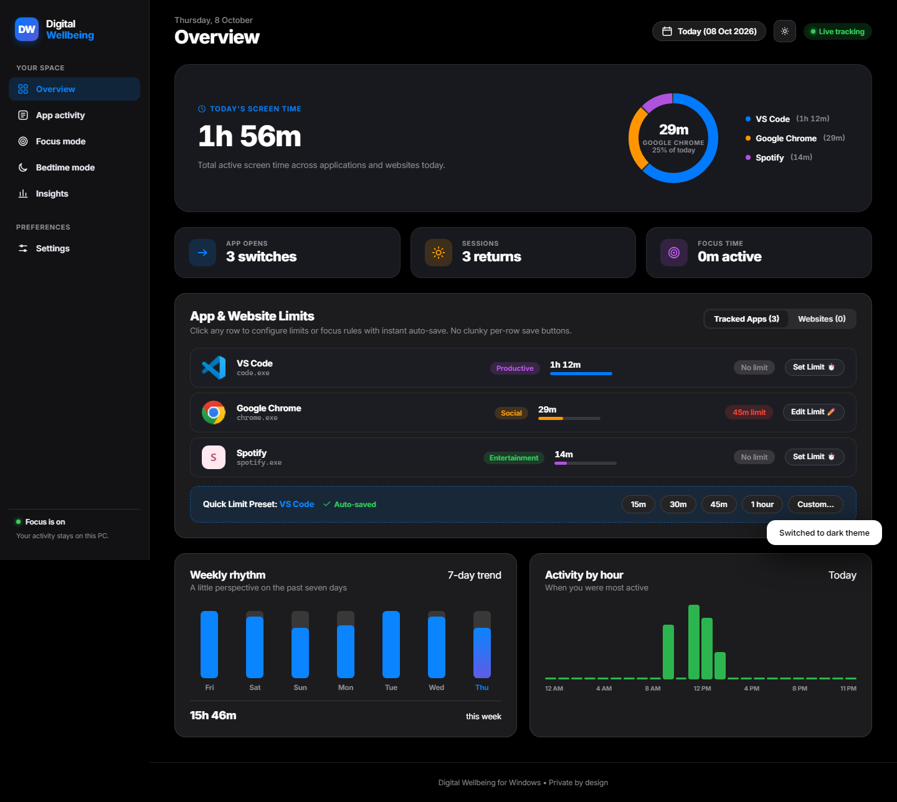
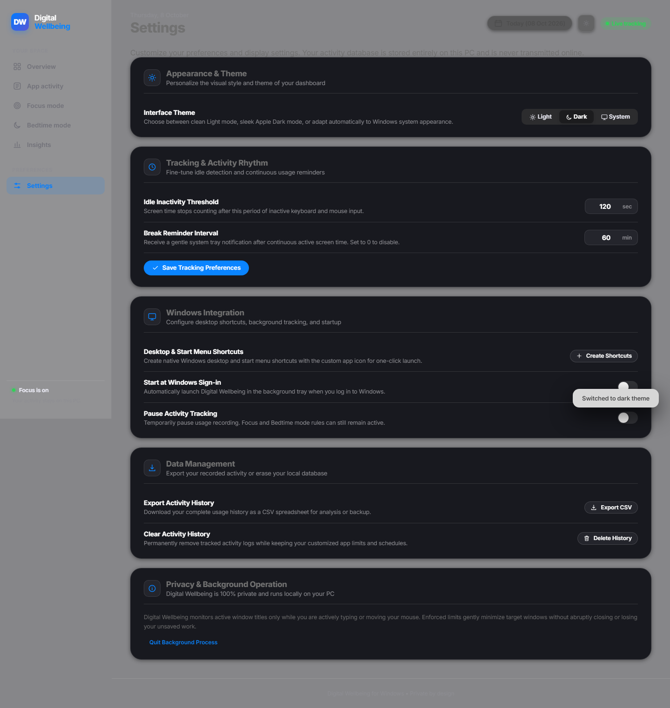

# Digital Wellbeing for Windows

A private, modern Windows desktop application with full feature parity inspired by Android Digital Wellbeing. It tracks your active foreground apps and websites, displays your daily and weekly rhythm with the signature multi-color donut chart, extracts authentic Windows application icons, and gives you gentle, customizable tools to protect your focus and sleep.

<p align="center">
  
</p>

---

## Quick Start

### 1. Launch the Desktop App
Double-click `DigitalWellbeing.exe` (or run `start.cmd` / `python run.py`).
- Runs as a **dedicated Windows Desktop App window** (borderless app mode without browser tabs or address bars).
- Minimizes cleanly to the Windows notification tray when minimized or closed.
- Real-time tray icon with quick controls to open the dashboard, pause tracking, or quit.

### 2. Desktop & Start Menu Shortcuts
Click **Settings → Create Desktop & Start Menu Shortcut** or run:
```powershell
py -3 -m scripts.create_shortcut
```
This generates authentic Windows `.lnk` shortcuts on your Desktop and Start Menu with the Digital Wellbeing icon.

---

## Android Feature Parity & Highlights

| Feature | Android Digital Wellbeing | Digital Wellbeing for Windows |
| :--- | :--- | :--- |
| **Signature Donut Chart** | Multi-colored radial chart with screen time center & app slices | Multi-colored interactive SVG donut chart with hover tooltips and app legend pills |
| **Real App Icons** | App icons shown next to usage | Native Windows Shell icon extraction (`SHGetFileInfoW` / `ExtractIconEx`) with RGBA PNG caching |
| **App Details Breakdown** | 24-hour hourly usage chart & quick timer chips | Interactive App Modal with 24-hour hourly usage bar chart, 15m/30m/1h quick preset chips, and category tags |
| **Website Timers** | Chrome website tracking & daily site limits | Tracks domains in Chrome, Edge, and Firefox; set daily website timers and focus blocks |
| **Bedtime Grayscale** | Screen turns black-and-white at bedtime | Hardware-accelerated fullscreen grayscale using Windows Magnification API (`Magnification.dll`) |
| **Bedtime Screen Tint** | Amber/warm night light screen dimming | Click-through full-monitor dark overlay with configurable opacity |
| **Focus Mode & Breaks** | Pause distracting apps with 5m, 15m, 30m break presets | Timed or indefinite focus sessions with "Take a Break" (5m, 15m, 30m), plus Select All / Clear All |
| **Snooze / Allow 5m** | Quick temporary extension when timer expires | One-click "Allow 5 more minutes" from dashboard notification toast or app row |
| **Standalone Window** | Dedicated native Settings UI | Runs in standalone Chromium/Edge App Mode (`--app=`) with custom window frame & tray integration |
| **Privacy by Design** | On-device data storage | 100% private SQLite database in `%LOCALAPPDATA%\DigitalWellbeing\wellbeing.sqlite3`. No cloud, no analytics, no external servers. |

---

## Key Features

### 1. Overview & Activity Rhythm
- **Signature Donut Chart**: Hover over any app segment to view its exact percentage and duration today, or click to open the App Details view.
- **Key Metrics**: Track foreground screen time, app opens (foreground switches), sessions (returns after being away), and active focus time.
- **Day-by-Day Activity & Hourly Pulse**: Visualizes daily screen time across the past seven days with rounded-corner bar metrics, hour scale lines, and interactive tooltips, alongside today's 24-hour activity distribution.

<p align="center">
  
</p>

### 2. App & Website Timers
- **App Timers**: Set daily time limits on any Windows application (e.g. `steam.exe`, `discord.exe`, `spotify.exe`). When a limit is reached, windows are gently minimized rather than killed.
- **Website Timers**: Switch to the **Websites** tab under App Activity to see time spent on specific domains (e.g. `youtube.com`, `reddit.com`, `twitter.com`) and apply individual daily limits.
- **Preset Chips**: Fast 15m, 30m, 45m, 1h, 1.5h, and 2h preset chips in the App Details modal.

<p align="center">
  
</p>

### 3. Focus Mode & Bedtime Mode
- **Focus Sprint**: Select distracting apps and websites to pause for 25m, 50m, 90m, or open-ended sprints.
- **Take a Break**: Pause focus for 5, 15, or 30 minutes without ending your session.
- **Native Windows Grayscale**: Android-style screen desaturation powered by `MagSetFullscreenColorEffect` from `Magnification.dll`.
- **Screen Dimming**: Translucent click-through dark overlay across all monitors to ease eye strain before sleep.

<p align="center">
  
  
</p>

### 4. Modern Aesthetics & Dark Theme
- **Deep Slate Dark Theme**: Beautiful modern dark mode matching Windows 11 Fluent Dark and Android Material You, featuring high-contrast luminous colors and deep cosmic gradients.
- **Instant Theme Toggle**: Switch between Light, Dark, or System Auto via the topbar icon or Settings. Zero-flicker pre-load script prevents flash of unstyled theme on launch.
- **Fluid Micro-Animations**: Interactive hover glows, page transitions, and spring toggle switches.

<p align="center">
  
  
</p>

### 5. Privacy & System Protection
- **No Keystroke / Title Snooping**: Only executable names and normalized website domains from browser titles are recorded. Never records URLs, form fields, keystrokes, or screen contents.
- **Protected System Apps**: Essential system utilities (`explorer.exe`, `taskmgr.exe`, `SearchHost.exe`, `SystemSettings.exe`, etc.) are hardcoded as protected and cannot be minimized or restricted.
- **Data Portability**: Full CSV export of daily usage and single-click history deletion while retaining rules and preferences.

---

## Technical Architecture

```
Digital Wellbeing/
├── digital_wellbeing/
│   ├── app_window.py       # Standalone Windows app launcher (Edge/Chrome --app mode)
│   ├── core.py             # Domain models (Policy, Observation, Rule, DayReport, Category)
│   ├── icons.py            # Windows Shell32/ExtractIconEx icon extractor & PNG cache
│   ├── platform_windows.py # Win32 API, screen dimmer, & Magnification API GrayscaleManager
│   ├── runtime.py          # App supervisor, background thread, & system tray lifecycle
│   ├── server.py           # Local authenticated REST server & static web assets handler
│   ├── service.py          # WellbeingService orchestrator (ticks, limits, focus, bedtime)
│   ├── shortcuts.py        # Windows Desktop & Start Menu shortcut generator (WScript.Shell)
│   ├── sites.py            # Browser domain parser & website activity tracker
│   ├── storage.py          # SQLite persistence (activity, rules, site usage, site rules)
│   └── web/                # High-fidelity dashboard (HTML5, Vanilla CSS, JS with SVG charts)
├── scripts/
│   ├── create_icon.py      # Generates assets/icon.ico
│   ├── create_shortcut.py  # Standalone CLI shortcut creator
│   └── ui_smoke.py         # Headless browser smoke test suite (Playwright)
├── tests/                  # 26 comprehensive unit tests (API, Core, Sites, Storage, Windows)
├── build.cmd               # One-click PyInstaller build script
├── start.cmd               # Launcher for executable or pythonw
└── DigitalWellbeing.spec   # PyInstaller bundle specification
```

---

## Verification & Building

### Running Tests and Linting
```powershell
# 1. Run unit test suite (26 tests)
py -3 -m unittest discover -s tests -v

# 2. Run Ruff linter
py -3 -m ruff check .

# 3. Run Mypy static type checker
py -3 -m mypy digital_wellbeing run.py scripts

# 4. Run JS syntax validator
node --check digital_wellbeing/web/app.js

# 5. Run headless browser visual smoke test
py -3 -m scripts.ui_smoke
```

### Packaging Single-File Binary
Run [build.cmd](build.cmd) or execute:
```powershell
py -3 -m PyInstaller DigitalWellbeing.spec --noconfirm
```
This builds `dist\DigitalWellbeing.exe`, bundled with all web assets, icons, and Windows API hooks.
